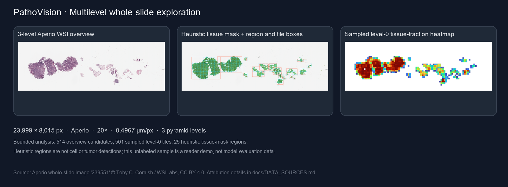

# PathoVision

**Tile-based histopathology image exploration with an optional PyTorch transfer-learning classifier.**

[](https://github.com/Bhagyalaxmi2/PathoVision/actions/workflows/checks.yml)

PathoVision is an engineering and learning prototype. It demonstrates image tiling, a lightweight tissue/background heuristic, quantitative summaries, visualization, and a ResNet-18 fine-tuning path for user-supplied labeled tile data.



## Current capabilities

- Includes a synthetic interface demo, clearly labeled as generated test data rather than medical data.
- Lets users browse PathMNIST held-out test patches and compare each ground-truth label with the model prediction.
- Reads PNG, JPEG, and TIFF previews; caps the longest analysis-image edge at 4,096 pixels and displays when an upload was resized.
- Optionally reads pyramid whole-slide formats through OpenSlide, computes an overview tissue mask, and reads at most 512 spatially distributed level-0 tiles for detailed measurements and compatible custom-checkpoint inference.
- Computes a heuristic tissue mask using HSV saturation/brightness and morphology.
- Detects connected components in the heuristic tissue mask, draws region boxes, and reports component area, bounding box, and centroid; WSI region coordinates and areas are mapped back to level-0 pixels and microns when metadata permits.
- Summarizes tissue-positive tiles with coordinates, dimensions, and tissue fraction.
- Adds a per-tile Laplacian-variance focus/detail proxy to support review of potentially soft regions; its scale-dependent score has no universal pass/fail cutoff.
- Reports measured analysis time for each image; the value depends on hardware, image size, sampled tiles, and whether a classifier is active.
- Shows a heuristic tissue overlay and a coarse per-tile tissue-fraction heatmap.
- Exports overlay, binary mask, tile heatmap, and tile-measurement CSV from the dashboard.
- Exports a privacy-conscious JSON run report with settings, summary metrics, source metadata, runtime, and checkpoint evaluation provenance; it omits uploaded filenames, paths, and image pixels.
- Keeps uploaded image analysis in memory; dashboard downloads are encoded on demand and are not automatically written to the project folder.
- Optionally loads a locally trained ResNet-18 tile classifier; checkpoint loading is cached and tile inference runs in bounded batches. The PathMNIST checkpoint is restricted to the held-out 28×28 benchmark-patch demo and is not applied to uploads or whole-slide tiles; custom ImageFolder checkpoints can be used for those inputs.
- Includes a fine-tuning script for class-folder datasets and reports validation accuracy, macro F1, per-class precision/recall/F1, and a confusion matrix.

## Engineering relevance

| Role area | PathoVision implementation | Scope boundary |
| --- | --- | --- |
| Digital pathology image handling | Optional OpenSlide pyramid reading, level-0 region access, slide metadata, and physical tile coordinates in `pathovision/wsi.py` | At most 512 spatially distributed level-0 tiles are sampled per run; physical units appear only when the slide provides valid microns-per-pixel metadata |
| Image processing, region detection, and quantification | OpenCV HSV/morphology tissue mask, connected-component region boxes, tile tissue fraction, focus/detail proxy, RGB summaries, overview heatmap | Regions are connected components of the heuristic mask; focus scores are scale-dependent, and regions are not cell, lesion, or tumor detections |
| Classification and deep learning | Fine-tuned torchvision ResNet-18 and bounded-batch tile inference | The PathMNIST result is a 28×28 benchmark pilot, not evidence for WSI classification |
| Model evaluation | Validation-based checkpoint selection, one held-out test pass, class metrics, and confusion matrix | Metrics are dataset-specific and not clinical validation |
| Practical software engineering | Modular pipeline, Streamlit review UI, bounded raster previews, streamed WSI patch inference, per-run runtime instrumentation, tests, and model card | Runtime is a local measurement, not a cross-machine benchmark; no production service, GPU optimization, or patient-level workflow is claimed |

## Setup

Python 3.10 or newer is recommended; this project was installed and smoke-tested with Python 3.14.5 on Windows.

```bash
python -m venv .venv
# Windows: .venv\Scripts\activate
# macOS/Linux: source .venv/bin/activate
python -m pip install --upgrade pip
pip install -r requirements.txt
streamlit run app.py
```

The included Streamlit settings bind the dashboard to this computer (`127.0.0.1`) and disable Streamlit usage statistics. The app is intended for local development and review.

Whole-slide formats such as SVS, NDPI, MRXS, and SCN use an optional OpenSlide reader. Install it with `pip install -r requirements-wsi.txt`. The WSI path analyzes a low-resolution overview and a bounded sample of level-0 tiles; it does not exhaustively analyze every tile. Standard image formats use the bounded 4,096-pixel preview path.

To enable the in-app whole-slide demo, install the optional reader and run `python -m pathovision.download_wsi_sample`. This downloads the 1.9 MB OpenSlide `CMU-1-Small-Region.svs` reader sample into the Git-ignored `data/wsi/` folder, verifies its SHA-256, and makes **OpenSlide sample slide (CC0)** appear in the image-source selector. To add a genuine three-level pyramid example, run `python -m pathovision.download_wsi_sample --multi-level`; this streams the pinned v8 fixture archive, extracts only the 25.4 MiB `239551.svs` slide, and verifies its SHA-256. The latter is CC BY 4.0 and requires attribution; see [data sources and attribution](docs/DATA_SOURCES.md). Its dimensions are 23,999 × 8,015 pixels and OpenSlide reports three pyramid levels. Both samples expose Aperio vendor metadata, 20× objective and scale; where valid scale metadata exists, tile CSVs include physical microns alongside level-0 pixel coordinates. Rerun the dashboard to refresh the source list. The slides are unlabeled reader/processing demos, not model-evaluation data. Small sample source: [OpenSlide test data](https://openslide.cs.cmu.edu/download/openslide-testdata/Aperio/CMU-1-Small-Region.svs); multi-level sample: [WSILabs fixture corpus](https://github.com/WSILabs/wsi-fixtures).

The dashboard starts with a generated synthetic interface demo so you can inspect the visual outputs immediately. Switch to **Upload image** to analyze a PNG/JPEG/TIFF image. The synthetic pattern is not a pathology specimen and is not used for model training or performance claims. The default PathMNIST classifier is used only when viewing its held-out patch demo; use a compatible custom tile checkpoint for uploaded-image or whole-slide inference.

## Optional transfer learning

Prepare **labeled, de-identified, appropriately licensed** tile images in torchvision ImageFolder layout:

```text
your_dataset/
  train/
    class_a/*.jpg
    class_b/*.jpg
  val/
    class_a/*.jpg
    class_b/*.jpg
```

For ImageFolder data, create a CSV manifest to verify patient/slide-level separation before training. Use consistent **non-identifying group codes** and paths relative to `your_dataset/`:

```csv
split,group_id,relative_path
train,slide_001,train/class_a/tile_001.jpg
train,slide_001,train/class_b/tile_002.jpg
val,slide_014,val/class_a/tile_003.jpg
test,slide_022,test/class_b/tile_004.jpg
```

Every image in the loaded splits must appear exactly once, and each group must occur in only one split. The manifest is read locally and not copied into the checkpoint or run report; only the group counts by split are recorded. If you omit it, training continues with a warning that independence was not verified.

Then run:

```bash
python -m pathovision.train your_dataset --group-manifest your_dataset/groups.csv \
  --epochs 10 --patience 3 --seed 42 --output models/resnet18.pt
```

The script fine-tunes an ImageNet-initialized ResNet-18, uses a fixed random seed, and saves the checkpoint with the best validation macro F1. It stops early after `--patience` epochs without an improvement. The checkpoint records the selected epoch, split sizes, and optional group counts. The repository does not redistribute trained pathology weights or the dataset. For credible evaluation, split by patient or slide (never random tiles from the same slide across train and validation), report per-class precision/recall/F1 and confusion matrix, and document cohort, stain, scanner, and class imbalance. The manifest audit verifies the provided mapping; it cannot infer whether group codes truly represent patients/slides or whether source labels are correct. Reported scores are only as credible as the data provenance, class balance, and group-level split. They are not clinical performance claims.

### Real-world PathMNIST benchmark

PathoVision can also train directly on PathMNIST from the official MedMNIST distribution. PathMNIST contains 89,996 training, 10,004 validation, and 7,180 test colorectal histology patches across nine tissue classes. The standard 28×28 release is about 206 MB and uses the provided train/validation/test split; the source project reports no whole-slide overlap across these splits. Its CC BY 4.0 terms require attribution. The 28×28 images are intentionally small and benchmark-oriented, so results do not establish performance on full-resolution slides or for diagnosis.

```bash
python -m pathovision.train data/medmnist --dataset pathmnist --download \
  --epochs 3 --patience 2 --image-size 28 --evaluate-test \
  --output models/pathmnist_resnet18.pt
```

`--download` fetches the official 206 MB PathMNIST file into `data/medmnist`; without it, training requires that file to be present already. The code selects the checkpoint using validation macro F1, then evaluates the held-out test split once. Optional `--max-train-samples` and `--max-val-samples` enable smaller pilot runs and their sample counts are recorded in the checkpoint. Cite the [MedMNIST v2 dataset paper](https://doi.org/10.1038/s41597-022-01721-8) and the [source PathMNIST study](https://doi.org/10.1371/journal.pmed.1002730) when reporting results. The data files are distributed from [official MedMNIST Zenodo](https://doi.org/10.5281/zenodo.10519652). Raw data under `data/` and trained weights under `models/` are excluded from Git.

#### Completed CPU pilot

The project has a completed transfer-learning pilot using ImageNet-initialized ResNet-18, 12,000 PathMNIST training patches, 2,000 validation patches, and the full 7,180-patch held-out test split. The checkpoint was selected on validation macro F1 and evaluated on the test split once.

| Split | Samples | Accuracy | Macro F1 |
| --- | ---: | ---: | ---: |
| Validation | 2,000 | 0.878 | 0.878 |
| Held-out test | 7,180 | 0.853 | 0.808 |

Reproduce the pilot after downloading the dataset:

```bash
python -m pathovision.train data/medmnist --dataset pathmnist --epochs 3 --patience 2 --image-size 28 --batch-size 64 --max-train-samples 12000 --max-val-samples 2000 --evaluate-test --output models/pathmnist_resnet18.pt
```

This is a benchmark result from a training subset, not a full-data leaderboard result. The dataset's small 28×28 patches and source split do not establish generalization to new institutions, scanners, whole-slide images, or clinical workflows. The local checkpoint is intentionally excluded from Git; the dashboard selects it automatically when present.

## Pipeline

```text
Image → RGB/WSI read → heuristic tissue mask → connected tissue regions + tissue-positive tiles
                                                 ┌───────────┴────────────┐
                                                 ↓                        ↓
                                   tissue/focus/region metrics   optional ResNet-18 scores
                                                 └───────────┬────────────┘
                                                             ↓
                                               overlays / heatmaps / CSV
```

## Limitations

- Tissue masking is a simple color heuristic and can fail across stains, scanners, artifacts, and tissue types.
- Standard raster uploads are bounded to a 4,096-pixel longest edge for preview analysis; reported tile sizes and coordinates refer to the resized analysis image. The optional OpenSlide workflow reads pyramid thumbnails and a sample of up to 512 level-0 tiles, so it is not an exhaustive whole-slide analysis system.
- Tile classifier outputs are experimental model scores, not calibrated probabilities or patient-level findings.
- This project is not clinically validated, does not diagnose disease, and must not guide patient care.
- The repository does not include a dataset or pretrained checkpoint. The optional PathMNIST workflow downloads public research data and can train a local checkpoint. Do not present benchmark results as clinical performance.

## Suggested resume description

Built a Python/OpenCV/Streamlit histology image-analysis prototype with bounded OpenSlide sampling, heuristic tissue segmentation, connected-region and tile quantification, and an optional PyTorch ResNet-18 transfer-learning workflow; documented dataset provenance, evaluation, and clinical-use limitations.

## License and data

PathMNIST is provided under CC BY 4.0; cite the MedMNIST and source dataset papers when reporting results. The dataset and trained checkpoint are excluded from this repository. Preserve attribution and the source dataset terms for any other data you use.

The optional multilevel Aperio slide is also CC BY 4.0 and requires the attribution recorded in [data sources](docs/DATA_SOURCES.md). Sample slide binaries are kept out of Git.

## Run checks

```bash
python -m unittest discover -s tests -v
```

The tests cover synthetic image processing, output encoding, JSON run-report privacy, classification metrics, focus-score behavior, bounded WSI sampling with a mocked reader, classifier batching, and patient/slide group-manifest validation. Separate smoke checks exercise the downloaded public slides and dashboard; none of these checks measure clinical or medical-model performance.
## Project notes

- [Model card: PathMNIST ResNet-18 pilot](MODEL_CARD.md)
- [Sample data sources and attribution](docs/DATA_SOURCES.md)
- [Architecture and data flow](docs/ARCHITECTURE.md)
- [Interview walkthrough and honest claim boundaries](docs/INTERVIEW_GUIDE.md)
- [Resume bullets, role mapping, and interview brief](docs/RESUME_AND_INTERVIEW.md)
