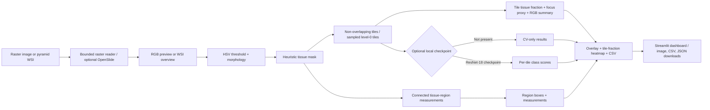

# Architecture and data flow

## Design decisions

- **Bounded image processing:** the raster reader caps the longest edge at 4,096 pixels. The optional OpenSlide path reads a thumbnail and at most 512 spatially distributed level-0 tiles. Level-0 measurements retain slide pixel coordinates; when valid microns-per-pixel metadata exists, tile CSV rows also include physical coordinates and dimensions. The overlay is drawn on the thumbnail. This is sampled analysis, not exhaustive WSI processing.
- **Heuristic tissue mask:** the baseline runs without a training dataset and is easy to inspect. HSV thresholds are stain-sensitive and are not a semantic segmentation model.
- **Connected-region detection:** OpenCV connected components report region bounding boxes, pixel area, and centroids from the heuristic mask. WSI region geometry is mapped from thumbnail pixels to level 0 and then to square microns when scale metadata exists. These are tissue-mask components, not detected cells or pathology findings.
- **Tile focus proxy:** Laplacian variance gives a lightweight edge-detail score for relative review within an image. It depends on image scale and tissue content; it is not a calibrated focus measure or universal quality threshold.
- **Runtime reporting:** the pipeline records elapsed analysis time for display in the dashboard. Values depend on hardware, image size, sampled tile count, and whether model inference is enabled; they are not a deployment benchmark.
- **Run report:** the JSON export records source category, settings, summary measurements, slide properties, elapsed time, and whitelisted checkpoint provenance. It deliberately excludes uploaded filenames, local paths, and image pixels.
- **Optional ResNet-18:** the training code fine-tunes an ImageNet-initialized backbone on labeled tiles or PathMNIST. Inference processes tiles selected by the tissue heuristic. The PathMNIST benchmark checkpoint is not applied to WSI tiles because its training patch scale differs.
- **Metrics:** validation accuracy, macro F1, per-class precision/recall/F1, and a confusion matrix help expose class imbalance better than accuracy alone. Split by patient or slide before tiling to reduce leakage.
- **Interpretability boundary:** tile scores describe model outputs. The app does not aggregate them into a patient-level finding.

## Current data boundary

The repository contains no pathology images, labels, or trained pathology checkpoint. Tests use a generated synthetic image only to check image-processing and file-export behavior.
